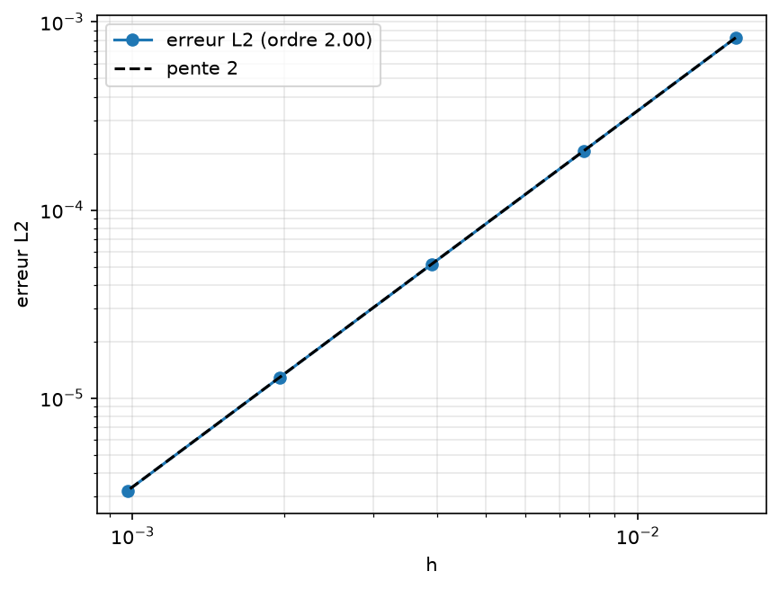

# Poisson 2D – SOR matrix-free en Fortran

Solveur de −Δu = f sur le carré unité, conditions de Dirichlet homogènes, sans bibliothèque externe. Défi Fortran, M1 Modélisation et Simulation Numérique, Université de Bordeaux (2026).

## Méthode
- Différences finies à 5 points (ordre 2), aucune matrice stockée.
- SOR avec ω optimal : ω = 2 / (1 + sin(πh)).
- Second membre précalculé, boucles ordonnées par colonnes (stockage Fortran).
- `resoudre_poisson_sor` : arrêt sur l'incrément, testé à chaque itération (version utilisée ci-dessous).
- `resoudre_poisson_sor_V2` : arrêt sur le résidu relatif, testé toutes les 5 itérations.

## Résultats
Cas u = sin(3πx) sin(πy).

| n | Erreur L2 | Temps (s) |
|---:|---:|---:|
| 64 | 8,240·10⁻⁴ | – |
| 128 | 2,059·10⁻⁴ | 0,06 |
| 256 | 5,146·10⁻⁵ | 0,40 |
| 512 | 1,286·10⁻⁵ | 2,97 |
| 1024 | 3,216·10⁻⁶ | 27,2 |

Ordre observé : 2,000. Temps : une seule exécution, Apple M1, gfortran 15.2, options du makefile (n = 64 omis : mesure dominée par le lancement).

### Gain de performance (rapport du Défi, octobre 2026)
Cas f1, n = 1024, mesuré avec `time` sous Linux.

| Étape | Temps (s) |
|---|---:|
| Compilation standard (`-Wall -Wextra`) | 53 |
| `-O3 -march=native -flto -ffast-math` | 20,7 |
| + second membre précalculé | 10,77 |

Soit environ ×5. Ces temps ne sont pas comparables à ceux du tableau précédent, mesurés sur une autre machine.



## Lancer
```sh
make
./exe 512                 # taille de grille, 512 par défaut
python3 convergence.py    # vérifie l'ordre 2 et trace la figure (NumPy, Matplotlib)
```
